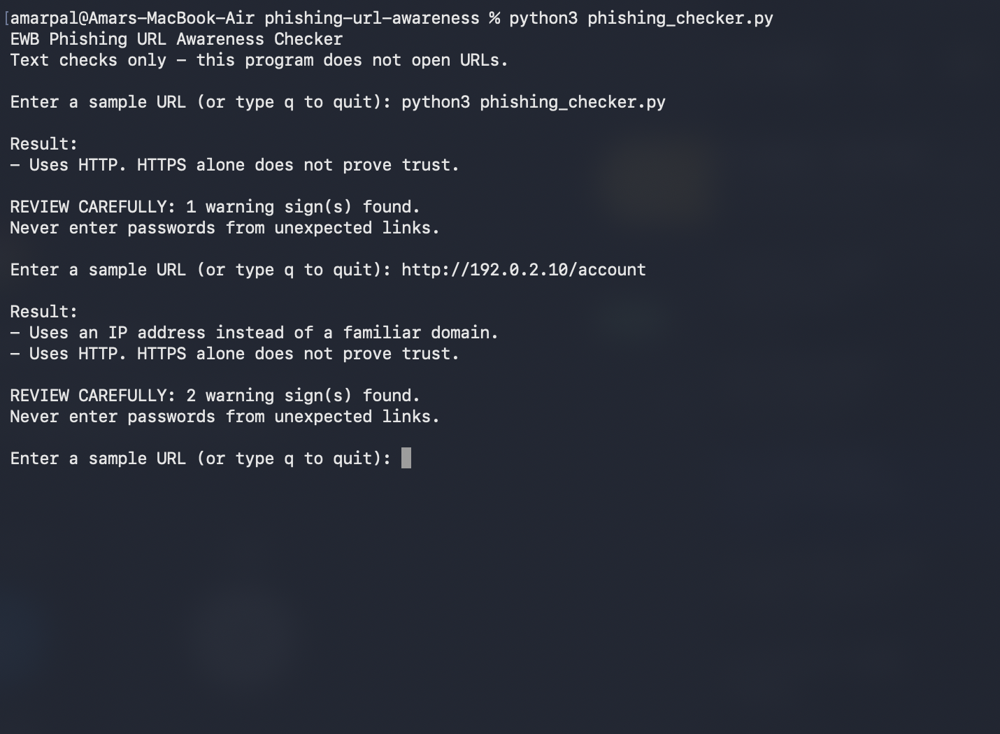
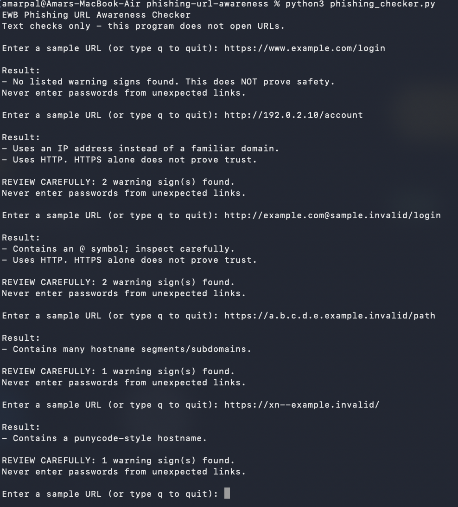

# EWB Phishing URL Awareness Checker

## Overview
Phishing is when someone sends a fake link to trick people into giving their password, OTP or card details. I built a small Python program that reads a URL as plain text and shows warning signs that I can check by eye. It never opens the link, so it is safe to use.

## Features
- Detects an @ symbol in the URL
- Flags unusually long URLs (over 100 characters)
- Flags IP-address hostnames
- Flags many hostname segments (5 or more)
- Flags punycode-style hostnames (xn--)
- Flags the HTTP scheme
- Loop with quit: check many URLs in one run and type q to exit
- "REVIEW CAREFULLY" summary with the number of warning signs
- Safe handling of malformed input so the program does not crash

## Requirements
Python 3.9 or later. No extra packages.

## How to Run
Windows: `python phishing_checker.py`

Mac/Linux: `python3 phishing_checker.py`

## Example Output
```
EWB Phishing URL Awareness Checker
Text checks only - this program does not open URLs.

Enter a sample URL (or type q to quit): http://192.0.2.10/account

Result:
- Uses an IP address instead of a familiar domain.
- Uses HTTP. HTTPS alone does not prove trust.

REVIEW CAREFULLY: 2 warning sign(s) found.
Never enter passwords from unexpected links.
```

## Testing
I ran five sample URLs on Python 3.9.6 (macOS). All five gave the expected result.

| # | Input | Expected | Actual | Result |
|---|-------|----------|--------|--------|
| 1 | https://www.example.com/login | No warning signs | No listed warning signs found | PASS |
| 2 | http://192.0.2.10/account | IP address + HTTP | IP address and HTTP warnings | PASS |
| 3 | http://example.com@sample.invalid/login | @ symbol + HTTP | @ symbol and HTTP warnings | PASS |
| 4 | https://a.b.c.d.e.example.invalid/path | Many hostname segments | Many hostname segments warning | PASS |
| 5 | https://xn--example.invalid/ | Punycode-style hostname | Punycode-style hostname warning | PASS |

The full table is in tests/test_samples.md.

## Screenshots



## Improvements
1. **Loop with quit** - Before, the program stopped after one URL. I added a while loop so I can check many URLs in one run and type q to quit. I tested it by entering all five sample URLs in a single run.
2. **Review carefully summary** - I wanted a clear message when something looks wrong. I added a small helper function that tells real warnings apart from information messages, and the program now prints how many warnings were found. I re-ran all five tests to make sure the results did not change.
3. **Malformed input handling** - Typing http://[bad used to crash the program with a ValueError. I added try/except so it now prints "This text is not a valid URL format." and keeps running. I tested it with http://[bad.

## Limitations
This is an educational tool. It only reads URL text. It does not visit
URLs, scan for malware or prove that a URL is safe. No warning signs
found does NOT mean a URL is safe.

## Ethical Use
Use sample strings only. Do not collect credentials. Do not use this
project to deceive anyone or to test websites without permission.

## Author
Pal Amar Rajesh, AI Powered Cybersecurity, EWB Courses
